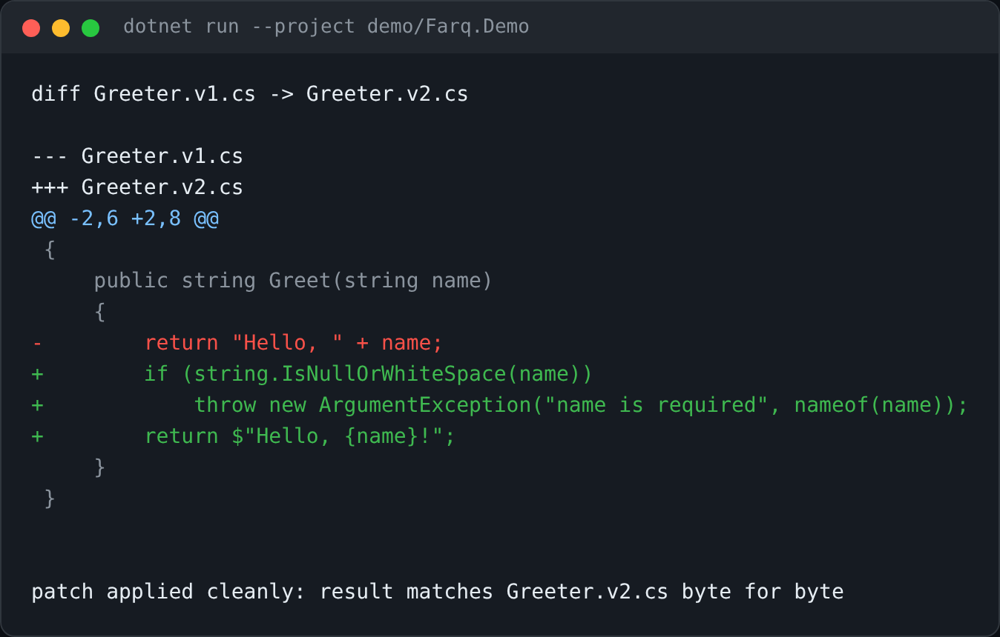
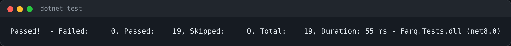

# farq — فرق

Line-based diff and patch for .NET: the Myers O(ND) algorithm produces the shortest edit script, `UnifiedDiff` formats it as a standard unified diff, and the patch applies back byte for byte. Zero dependencies.

[](https://github.com/SENESO/farq/actions/workflows/ci.yml)

## Quick start

```csharp
using Farq;

var script = Diff.Compute(oldLines, newLines);          // shortest edit script, both line numbers
string patch = UnifiedDiff.Format(script, "a.cs", "b.cs", context: 3);
var rebuilt = UnifiedDiff.Apply(oldLines, patch);       // == newLines, or PatchApplicationException
```

## What you get

- **`Diff.Compute`** — a `DiffLine` per line: `Equal` / `Removed` / `Added`, with 1-based line numbers in whichever version owns the line (both for `Equal`). The script is minimal, so unchanged content is maximally preserved.
- **`UnifiedDiff.Format`** — standard `---` / `+++` headers and `@@ -start,len +start,len @@` hunks, with configurable context. Changes closer than `2 * context` lines merge into one hunk, matching what `git diff` does.
- **`UnifiedDiff.Apply`** — replays the hunks, verifying every context and removed line at its declared position. Patches compose: later hunks see the shifted positions of earlier ones.

## Guarantees and limits

- **Exact application, no fuzz.** GNU patch will hunt for a shifted hunk; this library won't. A context mismatch throws `PatchApplicationException` instead of guessing.
- **Line granularity.** No intra-line (word/character) highlighting; a changed line is one removal plus one addition.
- **O(ND) time, O((N+M)·D) memory for the trace** — the classic Myers walk with per-step V-array snapshots. Fine for source files; don't diff million-line logs with it.
- **Newlines are boundaries.** Texts split on `\n`; a trailing newline becomes a trailing empty line, consistently in both directions.

## Demo

```
dotnet run --project demo/Farq.Demo
```

Diffs two versions of a C# file, prints the unified diff, then applies it and confirms the result matches the target byte for byte:



## Tests

```
dotnet test
```

19 tests: minimal-script checks, exact line numbering, hunk splitting and merging, malformed-header and mismatched-context rejection, and seeded random round-trips — `Apply(old, Format(Compute(old, new)))` must return `new` for every seed.



## License

MIT — see [LICENSE](LICENSE).
